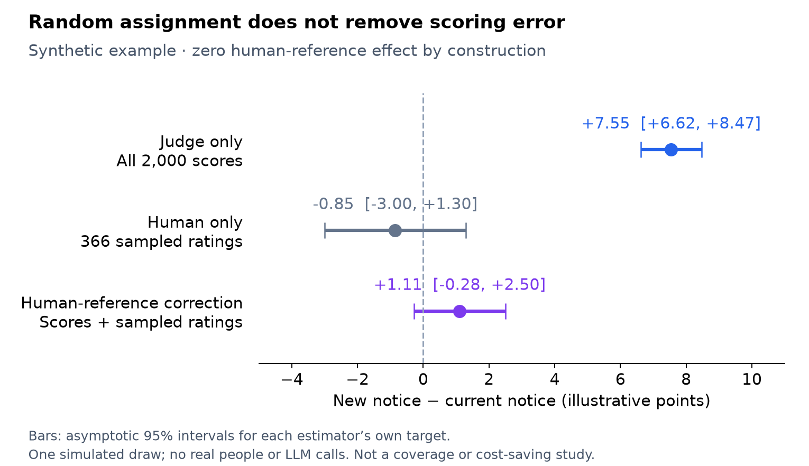
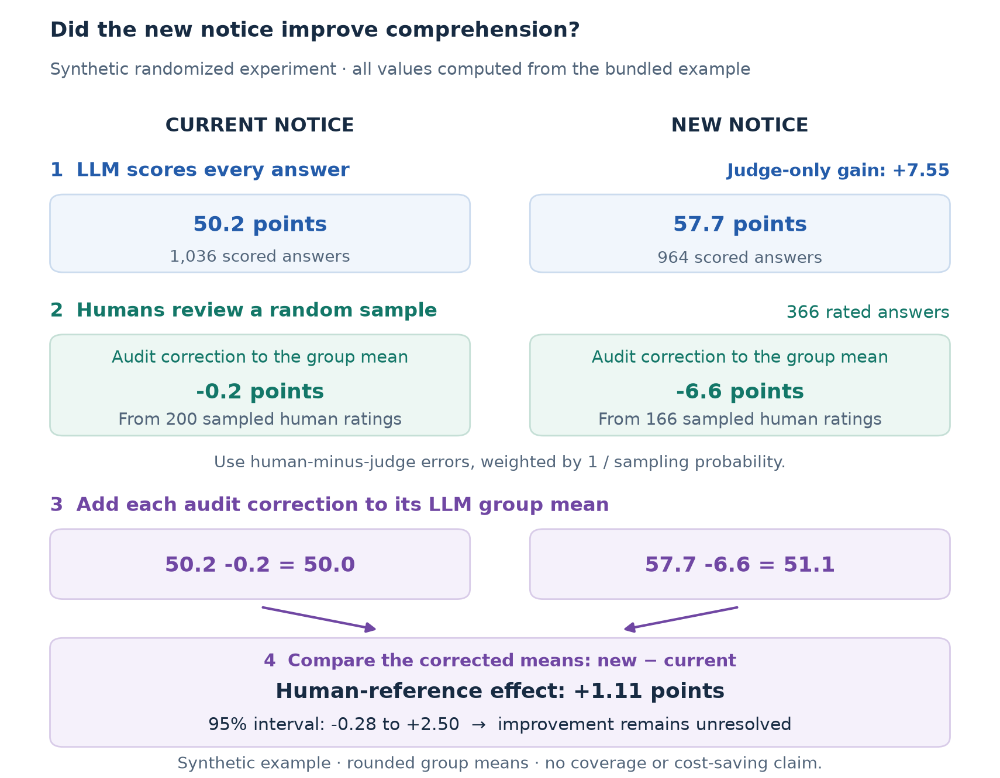
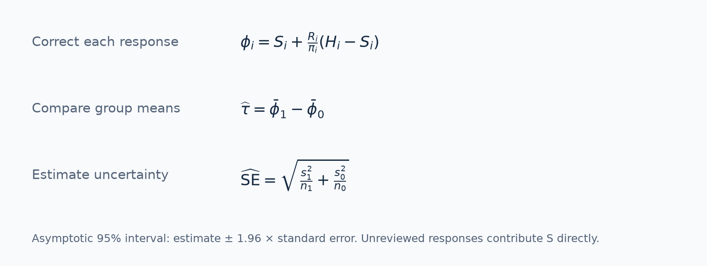
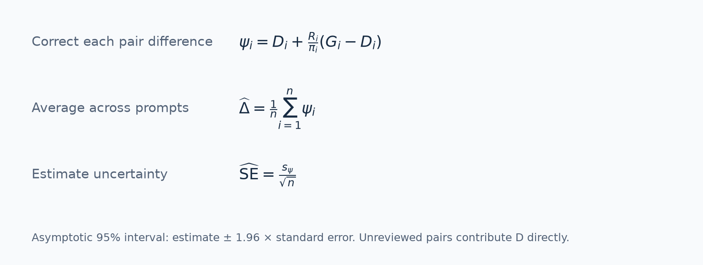

# LLM Evaluation with Human Audits

**Estimate experiment effects and model differences when an LLM scores the outcomes.**

LLMs are widely used as judges to score open-ended responses. They make it practical to evaluate text at scale, where human coding would be slow and expensive. But a higher judge score can reflect a change in wording, length, or style as well as a change in the outcome you care about.

[](https://github.com/yleng/llm-measurement-audit-release/actions/workflows/ci.yml)
[](pyproject.toml)
[](LICENSE)

I built `llmaudit` around a question from my research: **how can we use LLM scores to compare outcomes while keeping human judgment as the reference?** A score difference can reflect differences in quality, comprehension, or correctness, as well as how the judge responds to the text. Human ratings from a probability sample let us estimate the comparison under a specified human rubric.

The package combines scores for every response with human ratings from a probability sample. It returns the corrected difference, a confidence interval, and the judge-only result side by side. You can use it for randomized experiments or for comparing two checkpoints on the same prompts. [Background on LLM judges and their biases](https://arxiv.org/abs/2306.05685).

## Where to use it

| Field | Decision | Human-defined outcome |
|---|---|---|
| Marketing | Replace a notice | Correct understanding of the rule and next step. |
| Enterprise AI | Roll out a writing assistant | Factual accuracy and task completion. |
| Education | Choose tutoring feedback | Correct reasoning in a student's answer. |
| LLM evaluation | Select between two model versions | Response quality on the same prompts. |

These are intended applications; your rubric defines the outcome and needs substantive validation.

## See a human-audited experiment



In this **synthetic example**, the intervention has zero human-reference effect by construction, while the simulated judge gives its responses an eight-point bonus. The corrected effect is **+1.11 points, with a 95% interval of −0.28 to +2.50**: improvement remains unresolved.

Human-only analysis uses the same 366 sampled ratings. The correction has a narrower interval here, but its point estimate is farther from zero. This draw illustrates arithmetic, not general accuracy, coverage, or annotation savings.

[Read the short article](docs/articles/randomized-experiments.md) · [Generated report](examples/experiment-report.md)

## Try it

Python 3.10 or newer. No API key or third-party runtime dependencies for the base package.

```bash
git clone https://github.com/yleng/llm-measurement-audit-release.git
cd llm-measurement-audit-release

PYTHONPATH=src python -m llmaudit \
  --data examples/experiment.csv \
  --design examples/experiment_design.json \
  --output /tmp/llmaudit-experiment
```

Open `/tmp/llmaudit-experiment.md` for results and interpretation, or `.json` for structured results and provenance. Existing files are never overwritten; use a new prefix on subsequent runs.

## How the human audit works



The human audit lowers the new-notice mean much more than the current-notice mean. Correct each group separately, then compare the corrected means.

The audit observes human-minus-judge discrepancies. Weight them by their known selection probabilities and add them to the full-sample scores before comparing groups. A 20% inclusion probability gives weight five.

### The estimator

The default frozen-score route corrects each response, then compares the randomized groups:



- `S` is the judge score; `H` is the human rating.
- `R` is 1 for a reviewed response and 0 otherwise; `pi` is its known audit probability.
- `phi` is the corrected contribution. Within each group, `s²` is its sample variance and `n` is the group size.

Unreviewed responses contribute their judge score directly; missing human ratings never enter the calculation. The standard error accounts for population outcome variability and audit uncertainty under the stated design.

The estimator uses established generalized-difference / augmented inverse-probability weighting (AIPW), related to prediction-powered inference (PPI) and design-based supervised learning (DSL). Informative scores can improve precision by leaving smaller discrepancies to estimate. A gain is not guaranteed. [Equations and references](docs/method.md)

## Paired model evaluation and checkpoint comparisons

Evaluate both versions on the **same prompts** and human-rate both responses in each sampled pair. Paired inference preserves within-prompt dependence. Its target is a population mean quality difference, rather than a randomized treatment effect.

Apply the correction to **within-prompt differences**, then average across prompts:



`D` is the candidate-minus-baseline judge-score difference; `G` is the corresponding human-rating difference. `R` and `pi` refer to selection of the complete pair. `s_psi` is the sample standard deviation of corrected pair differences, and `n` is the number of prompts. Unreviewed pairs contribute `D` directly.

Run the same command with `examples/paired.csv` and `examples/paired_design.json`, using a new output prefix. [Paired input guide](docs/paired.md) · [Paired report](examples/paired-report.md)

## Bring your data

Supply a **CSV** of scores, sampled human ratings, and known audit probabilities, plus a **design JSON** specifying the comparison and frozen rules. Raw response text is not needed. [Randomized-experiment inputs and Python API](docs/usage.md) · [Paired inputs](docs/paired.md)

Both modes require IID units or pairs, independent Bernoulli audits, positive known inclusion probabilities, and complete returns. Randomized mode requires independent Bernoulli assignment with a common known probability. Paired audits require both ratings. The package analyzes supplied scores and audits.

Intervals target population effects or mean differences. Fixed-size/adaptive audits, clusters, repeated outcomes, shared coder effects, and conditional inference for a fixed archive need another analysis. [Full assumptions](docs/method.md)

## Guides and integrations

- [Method](docs/method.md): measurement-error correction, variance, and inference scope.
- [Contributing](CONTRIBUTING.md): tests and rebuilding figures.
- [Inspect adapter](integrations/inspect_ai/README.md): use completed evaluation logs with sampled human pair ratings; optional dependency.
- [PPI tutorial](integrations/ppi_py/README.md): a separate worked example using `ppi_py` APIs and independent labeled/unlabeled cohorts.

Install with `python3 -m pip install .` for the `llmaudit` command and Python API. [Attribution](NOTICE.md) · [MIT license](LICENSE) · [Citation](CITATION.cff)
