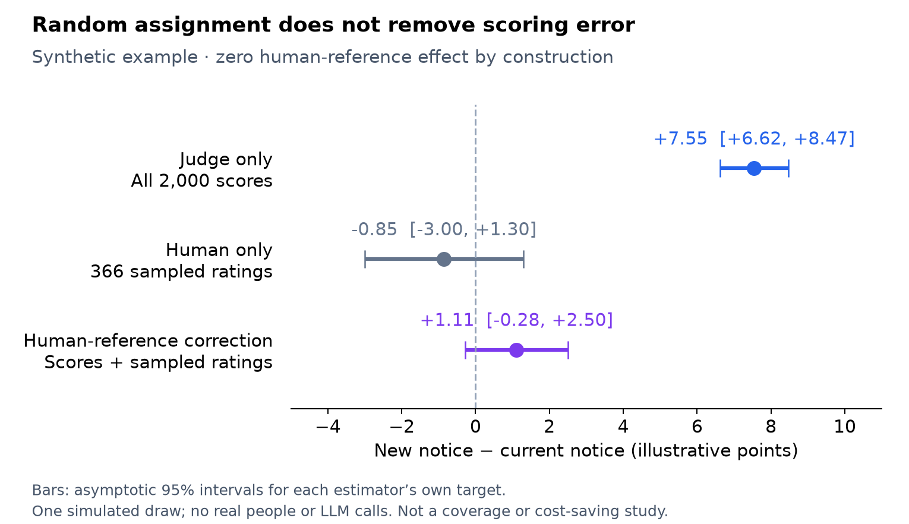
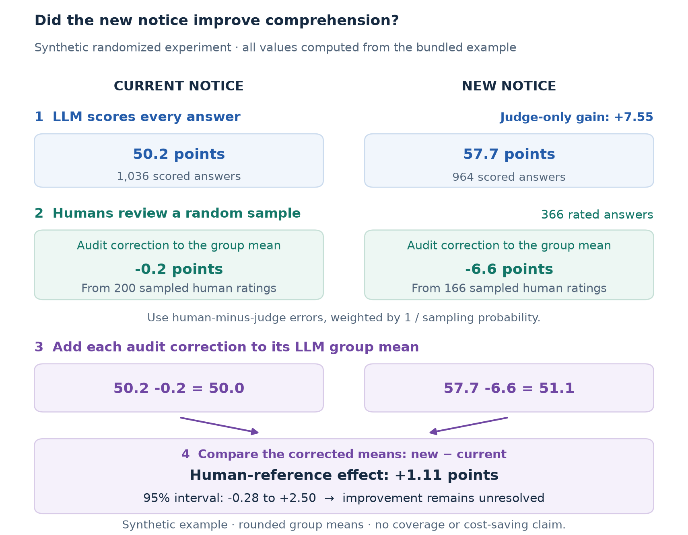
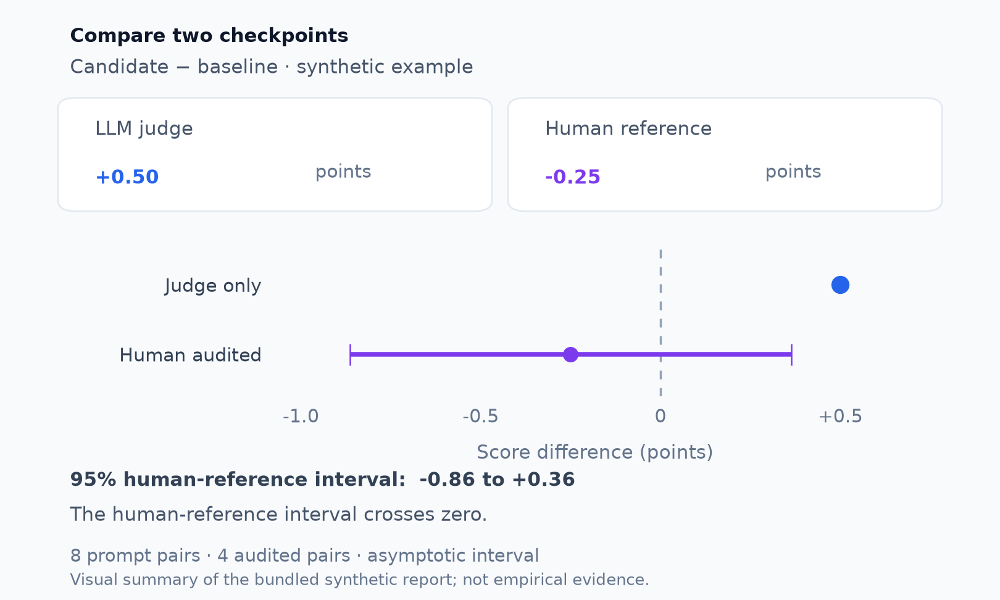

# Human-audited inference for LLM-scored experiments and model comparisons

*Yan Leng · November 2026*

LLMs are widely used as judges to score open-ended responses, from model outputs to customer feedback. They offer a practical way to turn text into scores when human coding at scale would be slow and expensive. Work such as [MT-Bench](https://arxiv.org/abs/2306.05685) also documents why those scores need care: judges can favor particular positions, longer answers, or their own outputs.

My interest is in what happens when we use those scores as experimental outcomes. An intervention may change both what people say and how they say it. If a judge responds to both, a well-randomized experiment can still leave us uncertain about the effect on the human-defined outcome. I built `llmaudit` to make that measurement question easier to examine with a probability sample of human ratings.

A team rewrites a fee notice to make it easier to understand. Participants are randomly assigned to the current or new version, then explain when the fee applies. An LLM scores every answer for comprehension. The new notice comes out ahead.

The team needs to know whether people understand the rule better. Random assignment identifies an effect on the **judge's score**. Whether that score captures better comprehension is a measurement question. The new notice may also change the wording people use, and the judge may reward that wording.

A similar question arises in model evaluation: when a checkpoint earns higher LLM-judge scores, does it also produce better responses under a human rubric?

The same audit calculation supports both comparisons: combine the full set of automated scores with probability-sampled human ratings, then estimate the human-reference difference and its confidence interval. The examples below show the calculation and how I would read the resulting report.

## LLM-as-a-judge bias can distort an A/B test

Consider two invented answers to “Does the fee apply if you cancel after the deadline?”

> “Yes, the fee applies.”
>
> “Yes. The policy clearly states that the fee applies when cancellation occurs after the deadline.”

A human rubric awarding a point for correctly identifying whether the fee applies gives both answers the same rating. Suppose the judge scores the second higher because it sounds more complete. If the new notice encourages that wording, the estimated score effect includes a style bonus alongside any comprehension effect.

The issue is whether measurement error differs between groups. An equal additive error cancels in their difference. An error favoring one group does not. High overall judge–human agreement does not establish that those errors cancel.

On a common numerical scale:

```text
Judge-score effect = human-reference effect
                   + difference in average judge–human error between groups
```

A larger experiment can give a precise judge-score estimate while leaving that discrepancy unresolved.

## Human-reference treatment effects: a worked example

The simulation creates 2,000 independent units, each assigned to a notice with probability 0.5. Human-reference scores have mean 50 and standard deviation 10. Each unit would receive the same human score under either notice, making the treatment effect zero by construction.

The simulated judge adds independent noise with standard deviation three and an eight-point bonus for the new-notice group. No real participants or LLM calls are involved; scores are illustrative points, not a validated comprehension scale.

Each answer is independently selected for human review with probability 0.2. This draw selects 366 answers. Twenty percent is the inclusion probability; the realized number reviewed is random.



| Analysis | Estimated difference | Asymptotic 95% interval |
|---|---:|---:|
| Judge scores for all 2,000 answers | +7.55 | +6.62 to +8.47 |
| Human ratings for the 366 audited answers | −0.85 | −3.00 to +1.30 |
| Full scores plus sampled human correction | +1.11 | −0.28 to +2.50 |

The judge-only interval resolves a positive effect on judge scores, which the simulation deliberately creates. Both human-reference intervals include zero: improvement remains unresolved. Including zero does not prove equivalence.

The correction has a narrower interval than human-only analysis in this draw, although its point estimate is farther from the known zero effect. One simulation illustrates the calculation; it establishes neither coverage nor typical superiority or annotation savings. Seeds are fixed without searching for a favorable draw.

## How probability-sampled human ratings correct the comparison

Freeze the judge, human rubric, and audit rule. Score every response and obtain all prescribed human ratings from the probability audit. For reviewed answers, calculate human score minus judge score. With 20% inclusion probability, weight each discrepancy by five:

```text
Reviewed:   corrected contribution = judge score + 5 × (human − judge)
Unreviewed: corrected contribution = judge score
```

Compare the group averages of these contributions. Under the declared sampling design, the weighted discrepancies represent errors across the full experiment. Unreviewed human ratings remain missing; they are never filled with zeros.



Informative scores can improve precision by accounting for outcome variation across the full sample. The human audit then estimates the remaining errors. The gain depends on those residuals; human-only analysis is a useful baseline.

The construction is established generalized-difference / augmented inverse-probability weighting (AIPW), related to [prediction-powered inference (PPI)](https://arxiv.org/abs/2301.09633) and [design-based supervised learning (DSL)](https://naokiegami.com/paper/dsl_ss.pdf). The package implements a local workflow with explicit sampling checks, reports, and interpretation.

## Paired model evaluation: compare checkpoints on the same prompts

For model selection, evaluate two prespecified checkpoints or system prompts on the same prompts. Human reviewers rate both responses in each sampled pair. The correction operates on within-prompt differences and retains their dependence when estimating uncertainty.



The separate eight-pair synthetic fixture gives a judge-only difference of **+0.50**, a corrected difference of **−0.25**, and an asymptotic 95% interval of **−0.86 to +0.36**. It demonstrates pairing and report interpretation; its small sample does not validate coverage. This estimates a prompt-population mean quality difference, rather than a randomized causal effect or uncertainty conditional on a fixed benchmark archive.

## Where the comparison matters

| Field | Decision | Human outcome to define |
|---|---|---|
| Marketing | Replace a notice | Correct understanding of the rule and next step. |
| Enterprise AI | Roll out an assistant | Factual accuracy and task completion in written work. |
| Education | Choose tutoring feedback | Correct reasoning in an independently scored answer. |
| LLM evaluation | Select between two model versions | Response quality on paired prompts under a common rubric. |

These are intended uses, not observed deployments. Each needs an appropriate design and a substantively valid human rubric.

## Run the package

With Python 3.10 or newer, from the repository root:

```bash
PYTHONPATH=src python -m llmaudit \
  --data examples/experiment.csv \
  --design examples/experiment_design.json \
  --output /tmp/llmaudit-experiment
```

For paired comparisons, use `examples/paired.csv`, `examples/paired_design.json`, and a different output prefix. The base package needs no API key or third-party runtime dependencies. Markdown reports show estimates, interpretation, audit coverage, and warnings; JSON retains structured results and provenance. The human-only baseline in the experiment figure is a documentation calculation, not an additional CLI feature.

Both modes assume IID units or pairs and independent Bernoulli audits with positive known probabilities and complete returns. Randomized mode requires independent Bernoulli assignment with a common known probability; paired audits require both ratings. Clustering, repeated outcomes, shared coder effects, fixed-size/adaptive audits, and inference for a fixed archive require another analysis. The interval concerns the specified human reference; it cannot establish that the rubric measures the intended construct.

[Experiment report](../../examples/experiment-report.md) · [Paired guide](../paired.md) · [Method and assumptions](../method.md) · [Example reproduction](../experiment-example.md)
