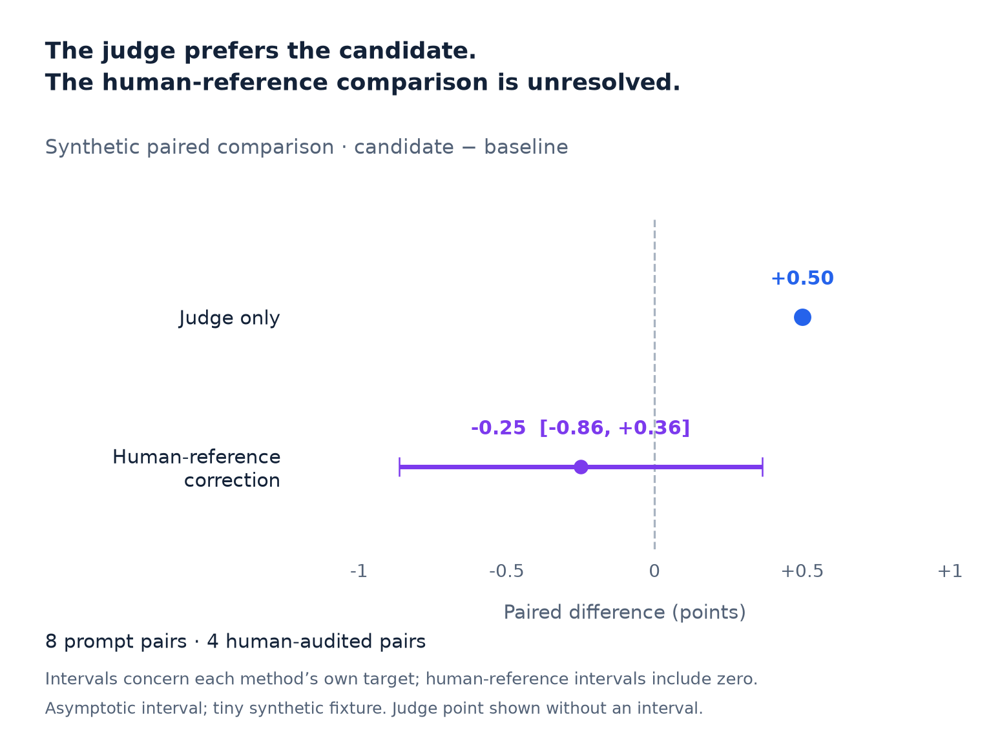
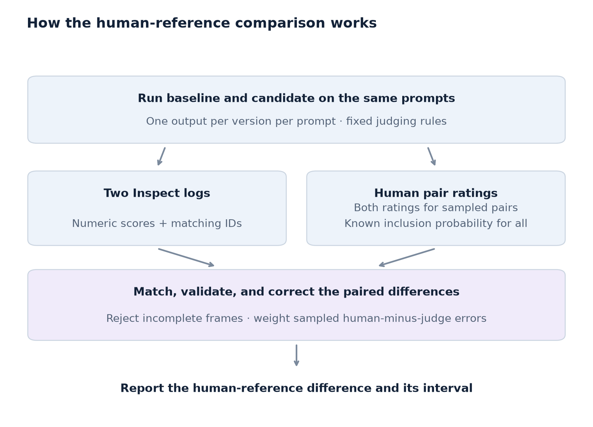

# Compare two Inspect runs against sampled human ratings

**Check whether an automated evaluation gain holds up under human review.**

You already have baseline and candidate runs in Inspect. This adapter combines their judge scores with sampled human ratings to estimate the difference under your human rubric, with a confidence interval. Use it when that difference matters to a release decision.

## Three comparisons worth checking

| Field | Decision | Why automated scores may be insufficient | What the human comparison should measure |
|---|---|---|---|
| Model evaluation | **Upgrade a checkpoint** | A more polished or verbose model can score better without providing more correct answers. | Factual correctness and task completion on the same prompts. Check whether the estimated gain supports the upgrade. |
| AI safety evaluation | **Change a refusal policy** | More refusals can raise a judge's safety score while making legitimate requests harder to complete. | A prespecified rubric covering appropriate refusal and useful help. Assess both aspects rather than treating refusal frequency as success. |
| Model compression & deployment | **Replace a model with a smaller one** | A cheaper model may keep a similar average judge score while losing response quality under the human rubric. | Human-rated quality differences on paired prompts. Compare the interval with a prespecified acceptable quality loss; measure cost and latency separately. |

These are supported comparison settings, not claims of adoption, safety certification, or proven cost savings. A single score resolves only the outcome its rubric defines.

## See the result



The judge favors the candidate, but the human-reference interval crosses zero. These data do not resolve an improvement. All eight prompt pairs and their ratings are fabricated; this small fixture demonstrates the integration, not reliable small-sample coverage or model-selection performance. [Generated report](example-report.md)

## How it works



The adapter reads the public Inspect log format, matches the same prompts by ID, and joins the sampled human pair ratings. It then uses the paired correction to estimate the human-reference difference. It is a local postprocessing adapter; no scorer registration, model calls, or audit sampling occurs.

## Try the synthetic example

Python 3.11 or newer is required by Inspect; the base package still supports Python 3.10. From the repository root, in a virtual environment:

```sh
python -m pip install '.[inspect]'

python -m llmaudit.inspect_adapter \
  --baseline integrations/inspect_ai/fixtures/baseline.json \
  --candidate integrations/inspect_ai/fixtures/candidate.json \
  --audit integrations/inspect_ai/fixtures/audit.csv \
  --design integrations/inspect_ai/fixtures/design.json \
  --scorer judge \
  --output /tmp/inspect-pairs.csv

python -m llmaudit \
  --data /tmp/inspect-pairs.csv \
  --design integrations/inspect_ai/fixtures/design.json \
  --output /tmp/inspect-human-audit
```

Use unused output paths; both commands refuse overwrites. The generated Markdown report contains the difference, interval, interpretation, and audit coverage; JSON contains the full structured result.

Python 3.12 with Inspect 0.3.287 was used for verification. Both `.json` and `.eval` logs are supported. [Validation and fixture reproduction](validation.md)

## Use your runs

Supply two complete, successful local logs and the exact numeric scorer name. IDs must identify the same prompts across runs, with one epoch and one output per prompt. The adapter matches by ID, regardless of row order, and requires identical inputs, targets, choices, and sample metadata. Self-contained text input only: files, sandboxes, multimodal content, and unresolved attachments are unsupported. Partial log frames, failed/invalidated/limited samples, changed configuration, repeated epochs, missing scores, categorical scores, and nonfinite values are rejected. There is no intersection filter or automatic score-to-number conversion.

Provide an audit CSV with exactly these columns and **one row for every prompt pair**, including unreviewed pairs:

| Column | Meaning |
|---|---|
| `pair_id` | Inspect sample ID as text; must match both logs. |
| `audited` | 1 if selected for complete human pair review, otherwise 0. |
| `human_label_0`, `human_label_1` | Both ratings for selected pairs; both blank otherwise. |
| `audit_probability` | Known positive pair-inclusion probability for every pair. |

Selections must be independent Bernoulli draws with a fixed rule and complete selected returns. Freeze the scorer, rubric, response-generation rules, and audit policy before collecting labels. A shared scorer key cannot establish the same judge/rubric; verify the actual judge settings yourself. Matching logs cannot establish representative IID prompts, independent sampling, construct validity, or absence of shared coder effects.

The target is the population mean human-reference difference over IID prompts under the specified generation rules. The same prompt appearing on both sides is handled as a pair. This is not a randomized causal effect or conditional uncertainty for a fixed benchmark archive. Fixed-size/adaptive audits, clustered/repeated prompts, or changing grader populations need separate analysis. [Paired method](../../docs/paired.md)

Raw prompt/output text stays out of the converted CSV and the aggregate report; pair IDs, scores, and human labels are present in the CSV. Treat real log/audit files as private data and keep them out of Git. The CLI accepts local files only.

[Inspect log API](https://inspect.aisi.org.uk/reference/inspect_ai.log.html) · [Paired method](../../docs/paired.md)
