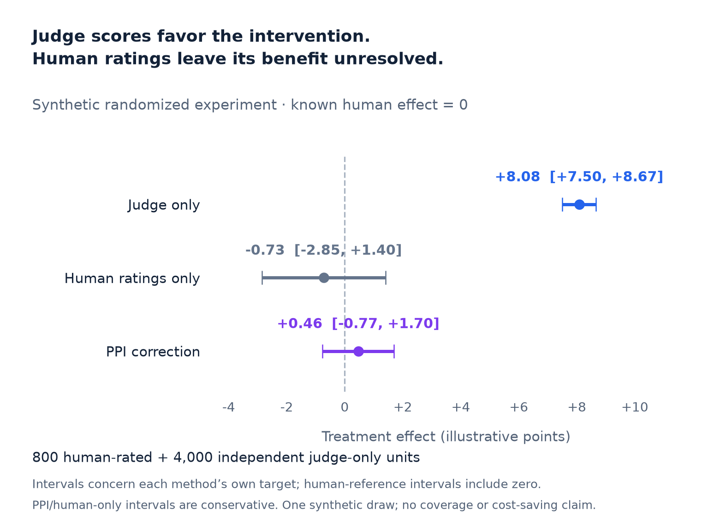
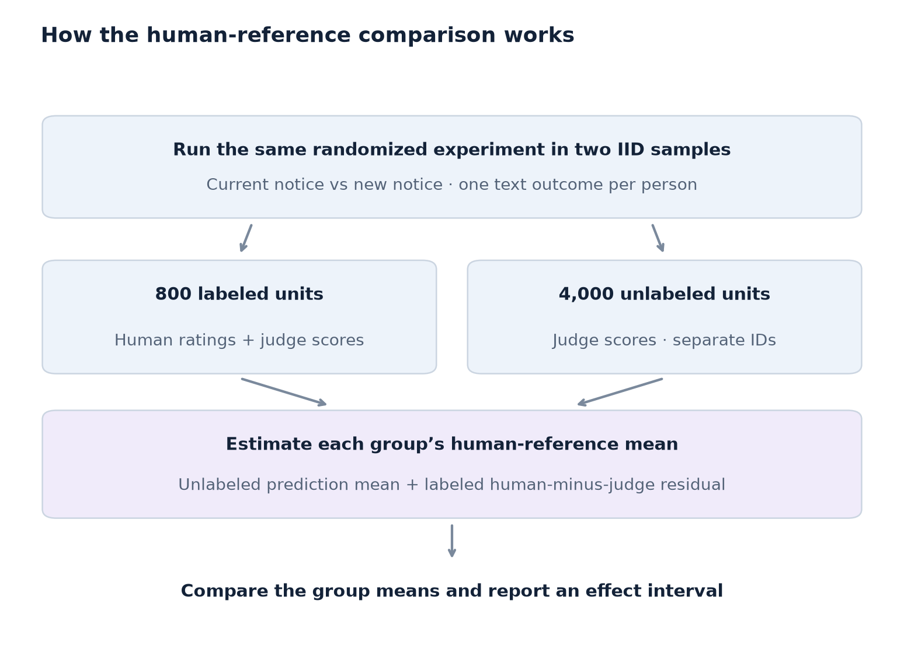

# Did the intervention work—or did the LLM judge prefer its wording?

**Estimate treatment effects on human-rated text outcomes with prediction-powered inference.**

You run a randomized experiment and collect written answers. An LLM can score thousands of responses, but the intervention may change the style the judge rewards. A polished answer can receive a higher score without becoming more correct. That can change which intervention you decide to deploy.

This notebook uses `ppi_py` to combine judge scores with human ratings and estimate the treatment effect under a specified human rubric, with a confidence interval.

## Where to use it

| Field | Use case | What you need to know | How judge scores can mislead | What to measure with human ratings |
|---|---|---|---|---|
| Marketing | **Replace a public notice** | Does a rewritten fee, eligibility, or consent notice help people understand what they must do? | The new notice changes the wording people repeat; the judge rewards that wording. | Whether the answer correctly identifies the relevant rule and next step. Use the estimated comprehension effect when deciding which notice to deploy. |
| Enterprise AI | **Roll out an AI writing assistant** | Does access to the assistant improve the accuracy and completeness of employees' written work? | The assistant produces confident, fluent prose that earns higher scores despite factual errors. | Correct facts and required task elements under a fixed rubric. Estimate the benefit of providing access before expanding the rollout. |
| Education | **Choose a tutoring intervention** | Do students explain the concept better after receiving a new kind of feedback? | Students adopt technical vocabulary that the judge mistakes for understanding. | Correct reasoning in one independently scored answer per student. Compare learning outcomes before choosing the feedback approach. |
| LLM evaluation | **Select between two models** | Does randomly routing an independent request between two prespecified models improve human-rated answer quality? | A judge may favor one model's style or verbosity over correctness. | Correctness and task completion under the same human rubric. Compare the estimated quality difference and its interval; assess cost and latency separately. |

The model-selection example randomizes independent requests between models; evaluating both models on the same prompts requires paired inference.

## See what changes after human review



The example creates **zero human-reference treatment effect**, while the simulated judge adds eight points to the intervention group. PPI estimates **+0.46 points, with a conservative nominal 95% interval of −0.77 to +1.70**. The data do not resolve whether the human-reference outcome improves.

Human-only analysis uses the same 800 ratings and also leaves the effect unresolved. PPI has a narrower interval in this draw. [Full numerical output](example-result.json)

## Run the notebook

Open the [worked notebook](randomized_text_experiment.ipynb), or run the script from the repository root:

```sh
python -m pip install -r integrations/ppi_py/requirements.txt
python integrations/ppi_py/randomized_text_experiment.py
```

All data are generated locally. No API key, model call, or dataset download is needed. Tested with Python 3.12 and `ppi-python` 0.2.3.

## How it works



The example has **800 labeled units** with human ratings and judge scores, and **4,000 independent unlabeled units** with judge scores. Both follow the same randomized assignment mechanism. Their IDs do not overlap.

Within each group, PPI estimates the human-reference mean as:

```text
mean judge score in the unlabeled sample
+ mean human-minus-judge discrepancy in the labeled sample
```

It then subtracts the control estimate from the intervention estimate. Informative judge scores can improve precision because the human sample estimates the remaining discrepancies. Human-only analysis remains a useful baseline; a precision gain is not guaranteed.

## Bring your own experiment

For each group, supply aligned human ratings and judge predictions for an IID labeled sample, plus predictions for a separate IID unlabeled sample from the same population and assignment design. Freeze the rubric and scoring rule. **Keep labeled observations out of `Yhat_unlabeled`.** The corrected estimate is meaningful for your question only if the human ratings measure the intended outcome.

The notebook uses the existing `ppi_mean_pointestimate` and `ppi_mean_ci` APIs with fixed `lam=1`. Two 97.5% asymptotic arm intervals are combined with Bonferroni to form a conservative nominal 95% effect interval. This requires the component intervals' asymptotic validity; it is not an exact finite-sample guarantee. Clustering, repeated outcomes, nonuniform/adaptive labeling, and population shifts require a different analysis. The illustrative 800-label count is not a sample-size recommendation.

[Statistical details and tests](method.md) · [ppi_py](https://github.com/aangelopoulos/ppi_py) · [Prediction-Powered Inference](https://arxiv.org/abs/2301.09633)
